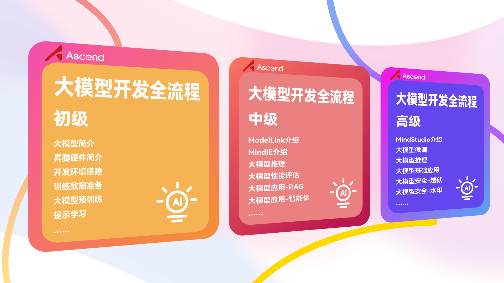
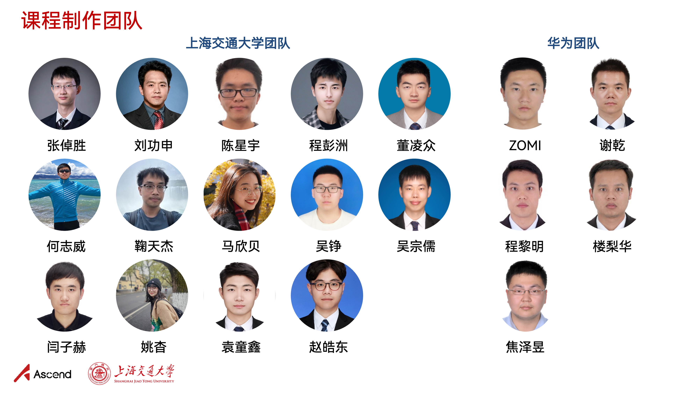
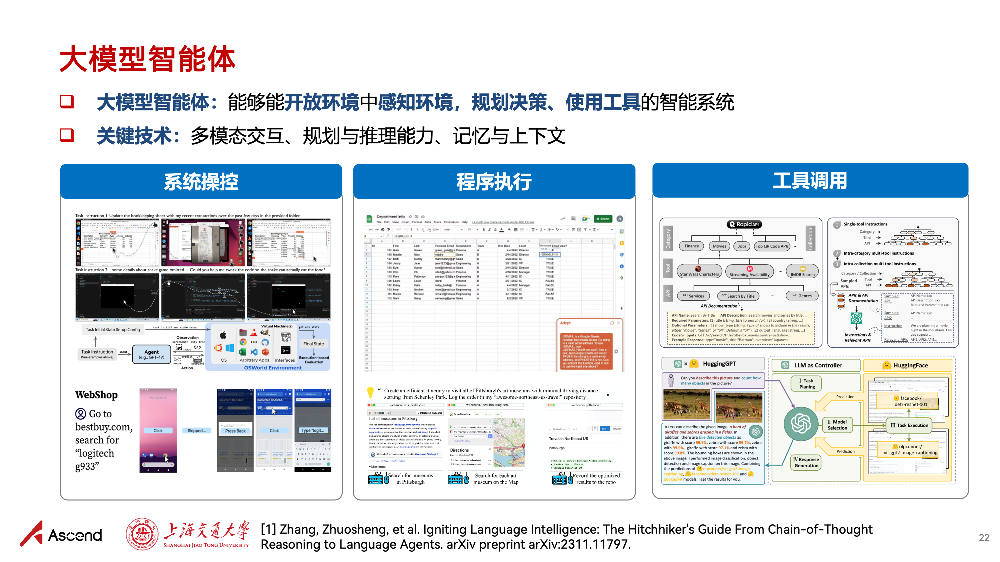

<h1 align="center">Dive into Large Language Models: A Programming Practice Tutorial Series</h1>

  	
  
  
   	
  	
    
     

  <a href="#-motivation">Motivation</a>/
  <a href="#-tutorial-contents">Tutorial Contents</a>/
  <a href="#️-contributors">Contributors</a>

## 💡 Updates

2025/06/06  Thank you all for your attention and active feedback! We have updated this tutorial in the following two aspects:

- [x] Launched the domestic (China-built) "Full Pipeline of LLM Development" public-interest tutorial (including slides, lab manuals, and videos). Special thanks to the Huawei Ascend community for their support!
- [x] Updated the content of the original programming practice tutorial series and added new topics (mathematical reasoning, GUI agents, LLM alignment, steganography, etc.)!

## 🎯 Motivation

The *Dive into Large Language Models* programming practice tutorial series grew out of the lecture notes of "Frontier Techniques in Natural Language Processing" (NIS8021) and "Artificial Intelligence Security Techniques" (NIS3353) at Shanghai Jiao Tong University (instructor: [Zhuosheng Zhang](https://bcmi.sjtu.edu.cn/home/zhangzs/)). It aims to provide an introductory programming reference for large language models. This tutorial is a public-interest project and is completely free. Through simple hands-on practice, it helps students quickly get started with large language models and better carry out course projects or academic research.

## 📚 Tutorial Contents

| Topic            | Description                                                  | Links                                                        |
| ---------------- | ------------------------------------------------------------ | ------------------------------------------------------------ |
| Fine-tuning & Deployment | A guide to fine-tuning and deploying pre-trained models: Want to improve a pre-trained model's performance on a specific task? Let's pick a suitable pre-trained model, fine-tune it on the target task, and deploy the fine-tuned model as an easy-to-use demo! | [[Slides](https://github.com/Lordog/dive-into-llms/tree/main/documents/chapter1/dive-into-llm.pdf)] [[Tutorial](https://github.com/Lordog/dive-into-llms/tree/main/documents/chapter1/README.md)] [[Notebook](https://github.com/Lordog/dive-into-llms/tree/main/documents/chapter1/dive-tuning.ipynb)] |
| Prompt Learning & Chain-of-Thought | A guide to calling LLM APIs and inference: "AI begs for encouragement online? The LLM's answers to some questions are jaw-dropping—but maybe it just wants a word of 'encouragement'." | [[Slides](https://github.com/Lordog/dive-into-llms/tree/main/documents/chapter2/dive-into-prompting.pdf)] [[Tutorial](https://github.com/Lordog/dive-into-llms/tree/main/documents/chapter2/README.md)] [[Notebook](https://github.com/Lordog/dive-into-llms/tree/main/documents/chapter2/dive-prompting.ipynb)] |
| Knowledge Editing | Methods and tools for editing language models: Want to control what a language model remembers about specific knowledge? Let's choose an appropriate editing method, edit the target knowledge, and verify the edited model! | [[Slides](https://github.com/Lordog/dive-into-llms/blob/main/documents/chapter3/dive_edit_0410.pdf)] [[Tutorial](https://github.com/Lordog/dive-into-llms/tree/main/documents/chapter3/README.md)]  [[Notebook](https://github.com/Lordog/dive-into-llms/tree/main/documents/chapter3/dive_edit.ipynb)] |
| Mathematical Reasoning | How can we teach LLMs to do mathematical reasoning? Let's quickly distill a mini R1! | [[Slides](https://github.com/Lordog/dive-into-llms/blob/main/documents/chapter4/math.pdf)] [[Tutorial](https://github.com/Lordog/dive-into-llms/tree/main/documents/chapter4/README.md)]  [[Notebook](https://github.com/Lordog/dive-into-llms/tree/main/documents/chapter4/sft_math.ipynb)] |
| Model Watermarking | Text watermarking for language models: embed human-imperceptible watermarks into content generated by language models | [[Slides](https://github.com/Lordog/dive-into-llms/blob/main/documents/chapter5/watermark.pdf)] [[Tutorial](https://github.com/Lordog/dive-into-llms/tree/main/documents/chapter5/README.md)]  [[Notebook](https://github.com/Lordog/dive-into-llms/tree/main/documents/chapter5/watermark.ipynb)] |
| Jailbreak Attacks | To achieve better security, start by learning how to attack. Let's see how jailbreak attacks pry open the LLM's mouth! | [[Slides](https://github.com/Lordog/dive-into-llms/blob/main/documents/chapter6/dive-Jailbreak.pdf)] [[Tutorial](https://github.com/Lordog/dive-into-llms/tree/main/documents/chapter6/README.md)] [[Notebook](https://github.com/Lordog/dive-into-llms/tree/main/documents/chapter6/dive-jailbreak.ipynb)] |
| LLM Steganography | "Invisible ink"! Want the LLM to answer fluently while secretly carrying information only "insiders" can recognize? LLM steganography shows you how! | [[Slides](https://github.com/Lordog/dive-into-llms/blob/main/documents/chapter7/stega.pdf)] [[Tutorial](https://github.com/Lordog/dive-into-llms/tree/main/documents/chapter7/README.md)] [[Notebook](https://github.com/Lordog/dive-into-llms/tree/main/documents/chapter7/llm_stega.ipynb)] |
| Multimodal Models | As multimodal large language models that can more fully simulate the real world, how do they achieve stronger multimodal understanding and generation capabilities? Can multimodal LLMs help realize AGI? | [[Slides](https://github.com/Lordog/dive-into-llms/blob/main/documents/chapter8/mllms.pdf)]  [[Tutorial](https://github.com/Lordog/dive-into-llms/tree/main/documents/chapter8/README.md)] [[Notebook](https://github.com/Lordog/dive-into-llms/tree/main/documents/chapter8/mllms.ipynb)] |
| GUI Agents | Want everything served to you on a platter and your hands free? Then let's have an AI agent order food, reply to messages, and compare prices for you! | [[Slides](https://github.com/Lordog/dive-into-llms/blob/main/documents/chapter9/GUIagent.pdf)]  [[Tutorial](https://github.com/Lordog/dive-into-llms/tree/main/documents/chapter9/README.md)] [[Notebook](https://github.com/Lordog/dive-into-llms/tree/main/documents/chapter9/GUIagent.ipynb)] |
| Agent Security | LLM agents are on their way to becoming the operating systems of the future. However, can LLMs recognize risks and threats in open agent scenarios? | [[Slides](https://github.com/Lordog/dive-into-llms/blob/main/documents/chapter10/dive-into-safety.pdf)] [[Tutorial](https://github.com/Lordog/dive-into-llms/tree/main/documents/chapter10/README.md)] [[Notebook](https://github.com/Lordog/dive-into-llms/tree/main/documents/chapter10/agent.ipynb)] |
| RLHF Safety Alignment | A PPO-based RLHF experiment guide: This tutorial is "extremely dangerous"—after reading it, please check whether your LLM is sneering. | [[Slides](https://github.com/Lordog/dive-into-llms/blob/main/documents/chapter11/RLHF.pdf)] [[Tutorial](https://github.com/Lordog/dive-into-llms/tree/main/documents/chapter11/README.md)] [[Notebook](https://github.com/Lordog/dive-into-llms/tree/main/documents/chapter11/RLHF.ipynb)] |

## 🔥 New: Domestic "Full Pipeline of LLM Development"

- **✨ Our public-interest tutorial "Full Pipeline of LLM Development", launched jointly with Huawei Ascend, is now live! Cutting-edge technology + hands-on code, guiding you step by step through AI large models ✨**:

  Building on the original *Dive into Large Language Models* tutorial series, we developed the *Full Pipeline of LLM Development* course series together with Huawei. This series is developed on Ascend's foundational hardware and software and covers slides, lab manuals, videos, and other formats. The tutorial is divided into beginner, intermediate, and advanced series to meet different LLM practice needs, aiming to use hands-on coding to provide researchers and developers with a full-pipeline development guide—from quick start to applying Ascend-supported models and migrating/tuning brand-new models—progressing from easy to advanced.

- **🚀 Explore the *Full Pipeline of LLM Development* series on the Ascend community**:

  👉 [LLM Development Learning Zone](https://www.hiascend.com/edu/growth/lm-development#classification-floor-1) @ Ascend Community 👈

- **✨ Course highlights ✨**

  <!-- 
  
  
   -->

  
  
  
  

## 🙏 Disclaimer

All content in this tutorial comes only from the contributors' personal experience, internet data, and relevant accumulation in daily research work. All techniques are for reference only and are not guaranteed to be 100% correct. If you have any questions, feel free to submit an Issue or PR. In addition, the badges used in this project come from the internet; if they infringe your image copyright, please contact us for removal. Thank you.

## 🤝 Contributing

This tutorial is currently a work in progress, so omissions are inevitable. Any PRs and issue discussions are welcome.

## ❤️ Contributors

Thanks to the following teachers and students for their support and contributions to this project:

**Development team of the *Dive into Large Language Models* tutorial series**:

- Shanghai Jiao Tong University: [Zhuosheng Zhang](https://bcmi.sjtu.edu.cn/home/zhangzs/), [Tongxin Yuan](https://github.com/Lordog), [Xinbei Ma](https://scholar.google.com/citations?user=LpUi3EgAAAAJ&hl=zh-CN&oi=ao), [Zhiwei He](https://zwhe99.github.io), [Wei Du](https://scholar.google.com/citations?user=tFYUBLkAAAAJ&hl=en), [Haodong Zhao](https://dongdongzhaoup.github.io/), [Zongru Wu](https://zrw00.github.io/), [Zheng Wu](https://wuzheng02.github.io/), [Lingzhong Dong](https://github.com/LZ-Dong), [Yulong Zhang](https://aslan-yulong.github.io/)

- National University of Singapore: [Hao Fei](http://haofei.vip/)

**Development team of the *Full Pipeline of LLM Development* tutorial series:**

- Shanghai Jiao Tong University: [Zhuosheng Zhang](https://bcmi.sjtu.edu.cn/home/zhangzs/), [Gongshen Liu](https://infosec.sjtu.edu.cn/DirectoryDetail.aspx?id=75), [Xingyu Chen](https://scholar.google.com/citations?user=d-dNtjrMJ5YC&hl=en), [Pengzhou Cheng](https://scholar.google.com/citations?user=qxnwzDUAAAAJ&hl=en), [Lingzhong Dong](https://github.com/LZ-Dong), [Zhiwei He](https://zwhe99.github.io), [Tianjie Ju](https://scholar.google.com/citations?user=f8PPcnoAAAAJ&hl=en), [Xinbei Ma](https://scholar.google.com/citations?user=LpUi3EgAAAAJ&hl=zh-CN&oi=ao), [Zheng Wu](https://scholar.google.com/citations?hl=zh-CN&user=qBM1UbUAAAAJ&view_op=list_works&gmla=AIfU4H6PG9JyjRub6BYIIZ4isQE7MBAM3Eoec6OJfX4z_8-pOE8bI1Wgdo3XL5qOZWR3U-h-lIP2q0zXt5gzyFKMSg7MNnBBWLv5d1IVG30UANczTP0), [Zongru Wu](https://zrw00.github.io/), [Zihe Yan](https://scholar.google.com/citations?user=O2YfSHoAAAAJ&hl=zh-CN), [Yao Yao](https://scholar.google.com/citations?user=tLMP3IkAAAAJ), [Tongxin Yuan](https://github.com/Lordog), [Haodong Zhao](https://dongdongzhaoup.github.io/);

- Huawei Ascend Community: ZOMI, Qian Xie, Liming Cheng, Lihua Lou, Zeyu Jiao

## 🌟 Star History

