# Fine-tuning and Deployment of Pre-trained Language Models

> Introduction: This section introduces pre-trained model fine-tuning.
Want to improve a pre-trained model's performance on a specific task? Let's choose an appropriate pre-trained model, fine-tune it on the target task, and deploy the fine-tuned model as an easy-to-use demo!
## Tutorial Goals:
1. Become familiar with the Transformers toolkit
2. Master fine-tuning and inference of pre-trained models (decoupled customizable version & default integrated version)
3. Master demo deployment with Gradio Spaces
4. Understand the selection and application scenarios of different types of pre-trained models
## Tutorial Contents:
### 1. Preparation:
#### 1.1 Get to know the toolkit: Transformers
https://github.com/huggingface/transformers

> 🤗 Transformers provides APIs and tools to easily download and train state-of-the-art pre-trained models. Using pre-trained models can reduce compute costs and carbon emissions, and save the time and resources needed to train from scratch. These models support common tasks across different modalities, such as:
📝 Natural language processing: text classification, named entity recognition, question answering, language modeling, summarization, translation, multiple choice, and text generation.
🖼️ Computer vision: image classification, object detection, and semantic segmentation.
🗣️ Audio: automatic speech recognition and audio classification.
🐙 Multimodal: table question answering, optical character recognition, information extraction from scanned documents, video classification, and visual question answering.

Detailed documentation (in Chinese): https://huggingface.co/docs/transformers/main/zh/index

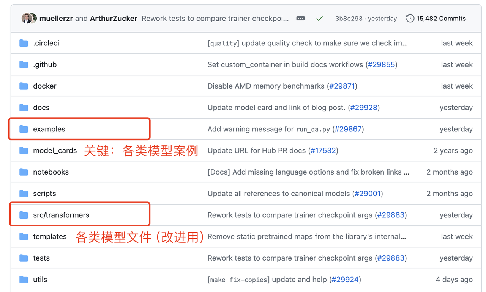

#### 1.2 Install the environment: taking text classification (e.g., fake news detection) as an example
1. Go to the text classification examples repository, refer to the README to learn about the key parameters, and download requirements.txt and run_classification.py

https://github.com/huggingface/transformers/tree/main/examples/pytorch/text-classification

2. Install the environment:
- 1. Create a new environment with conda: conda create -n llm python=3.9
- 2. Activate the virtual environment: conda activate llm
- 3. pip install transformers
- 4. Remove the automatically installed torch from requirements.txt, then run pip install -r requirements.txt

> If downloads are slow, you can use a mirror: pip [Packages] -i https://pypi.tuna.tsinghua.edu.cn/simple

> If you install PyTorch from a mirror, the CPU version of PyTorch will be selected automatically and GPU acceleration will not work, therefore—

- 5. conda install pytorch

> If downloads are slow, you can configure a conda mirror by following this blog: https://blog.csdn.net/weixin_42797483/article/details/132048218

3. Prepare data: we use the fake tweets dataset on Kaggle as an example: https://www.kaggle.com/c/nlp-getting-started/data

#### 1.3 Prepared project packages (demo code and data)
(1) Decoupled customizable version (key modules are decoupled for easier understanding; you can customize data loading, model structure, evaluation metrics, etc.)

[TextClassificationCustom download link](https://pan.quark.cn/s/00dae5c2b128)

(2) Default integrated version (the code is richer and
more complex; you generally just call it with hyperparameters, with a slight development threshold)

[TextClassification download link](https://pan.quark.cn/s/9d0510f1c98d)


### 2. Custom development based on the decoupled version (minimum viable product, MVP)
There are three main files: main.py (the main program), utils_data.py (data loading and processing), and modeling_bert.py (model structure)

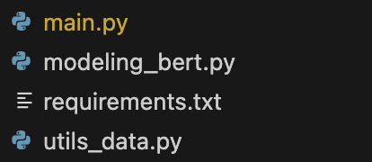

#### 2.1 Understand the key modules
1. Load and process data (utils_data.py)
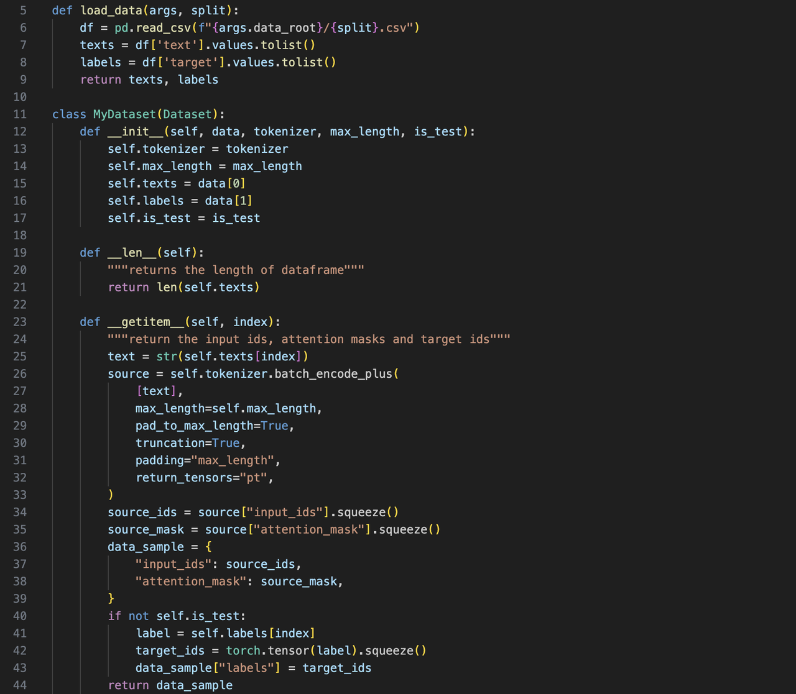

2. Load the model (modeling_bert.py)


3. Train/validate/predict (main.py)

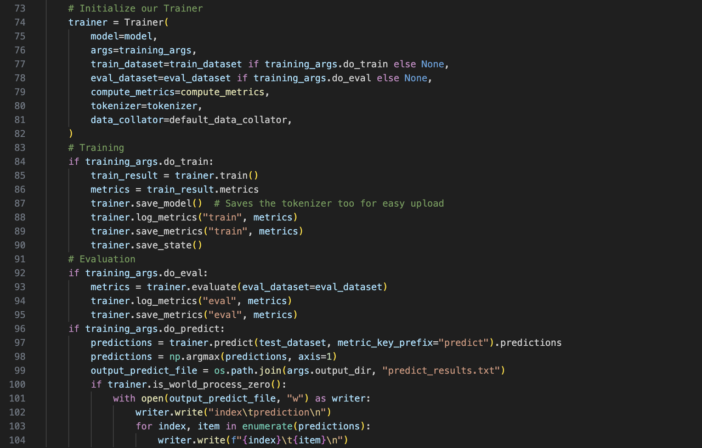

#### 2.2 Run the whole train/validate/predict pipeline
```shell
python main.py
```

### 3. Fine-tuning based on the integrated version (Optional, based on run_classification.py)

#### 3.1 Understand the key modules:
1. Load data (csv or json format)
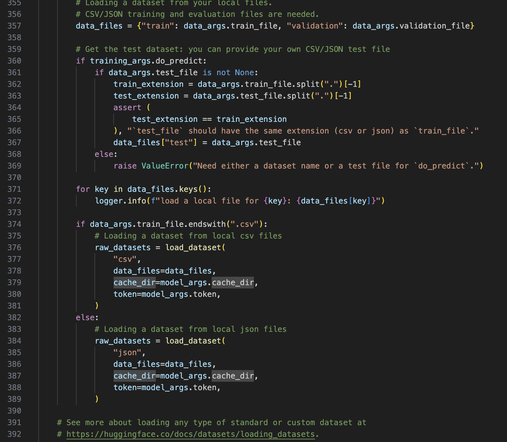

2. Process data
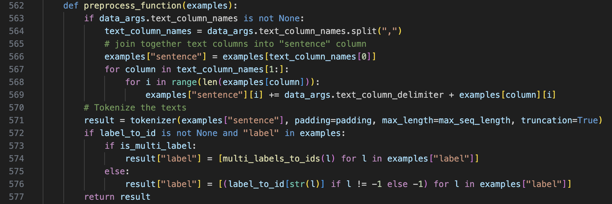

3. Load the model
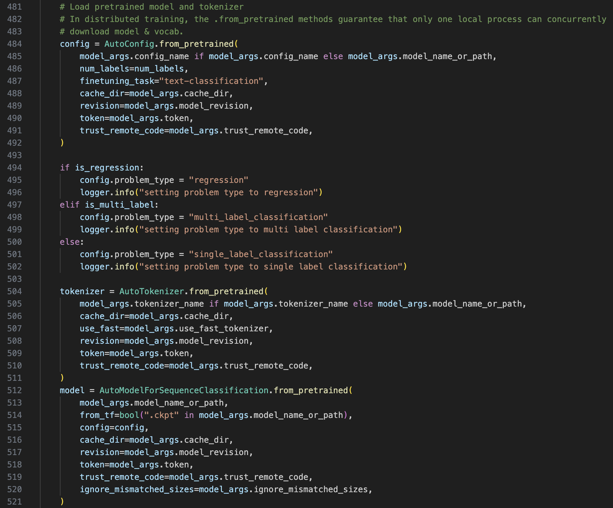

4. Train/validate/predict
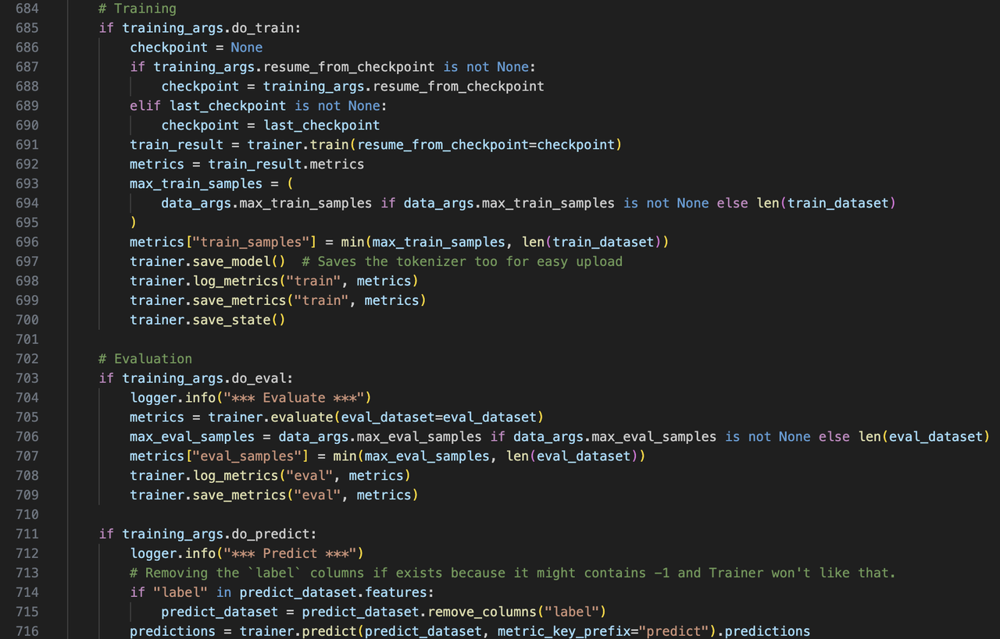

#### 3.2 Train the model
Validate on the development set and predict on the test set at the same time by running the following script:

```shell
python run_classification.py \
    --model_name_or_path  bert-base-uncased \
    --train_file data/train.csv \
    --validation_file data/val.csv \
    --test_file data/test.csv \
    --shuffle_train_dataset \
    --metric_name accuracy \
    --text_column_name "text" \
    --text_column_delimiter "\n" \
    --label_column_name "target" \
    --do_train \
    --do_eval \
    --do_predict \
    --max_seq_length 512 \
    --per_device_train_batch_size 32 \
    --learning_rate 2e-5 \
    --num_train_epochs 1 \
    --output_dir experiments/
```

If errors occur or the process hangs, it is usually a network issue:

1. <u>If "Network is unreachable" appears while downloading the model, download the model manually to your local machine: https://huggingface.co/google-bert/bert-base-uncased</u>
2. <u>If it hangs after data loading and, after you press CTRL+C to terminate it, shows it was stuck at "connection", this is caused by a failed network connection while the evaluate package is loading the metric.</u>

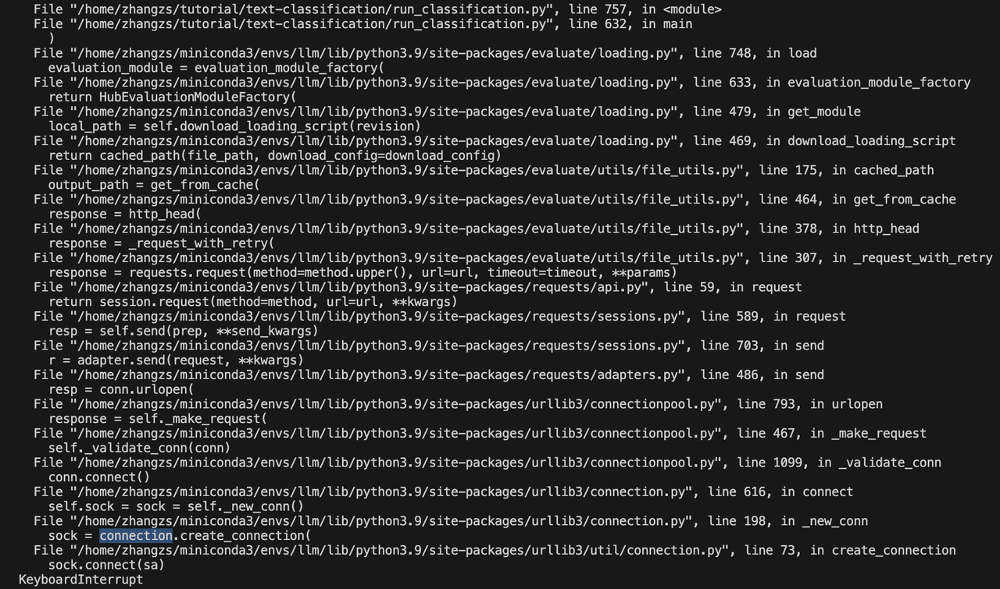

In this case, you can download the entire evaluate package from GitHub: https://github.com/huggingface/evaluate/tree/main, and change the --metric_name path in the hyperparameters to the local metric path, that is:

```shell
python run_classification.py \
    --model_name_or_path  bert-base-uncased \
    --train_file data/train.csv \
    --validation_file data/val.csv \
    --test_file data/test.csv \
    --shuffle_train_dataset \
    --metric_name evaluate/metrics/accuracy/accuracy.py \
    --text_column_name "text" \
    --text_column_delimiter "\n" \
    --label_column_name "target" \
    --do_train \
    --do_eval \
    --do_predict \
    --max_seq_length 512 \
    --per_device_train_batch_size 32 \
    --learning_rate 2e-5 \
    --num_train_epochs 1 \
    --output_dir experiments/
```

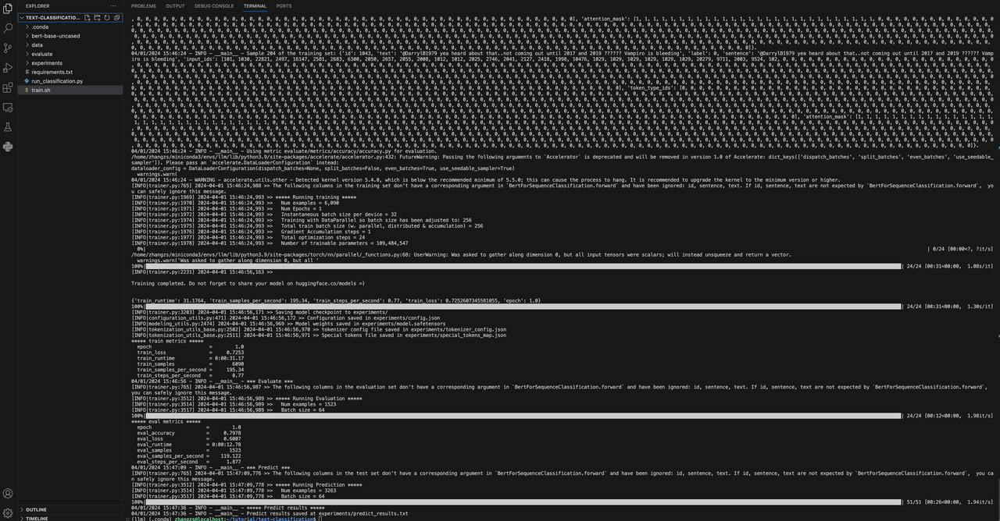


### 4. Deploy the model: after training, we can build online demos on Gradio Spaces
#### 4.1 Gradio Spaces tutorial
https://huggingface.co/docs/hub/en/spaces-sdks-gradio
#### 4.2 Create a Space
1. https://huggingface.co/new-space?sdk=gradio
2. Note: if it won't open, try using a VPN


#### 4.3 Key inference code
See app.py in the project package for details.

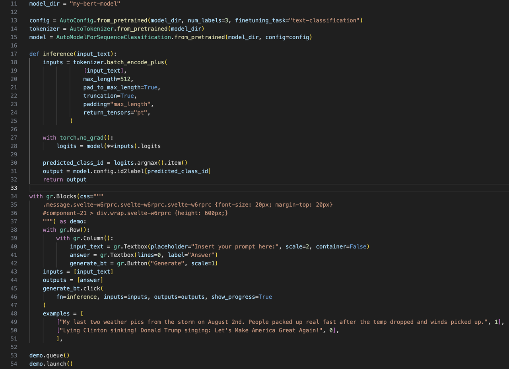

#### 4.4 Upload app.py, the environment configuration file, and the model to Gradio Spaces
1. Configuration file (requirements.txt)
```
transformers==4.30.2
torch==2.0.0
```

2. File overview

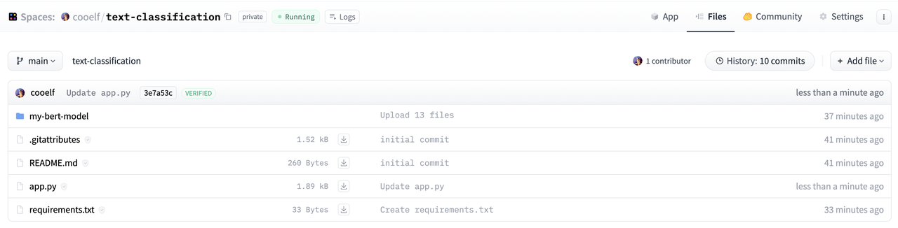


3. Demo result
A successfully deployed example for reference: https://huggingface.co/spaces/cooelf/text-classification
The source code can be found in the "Files" tab in the upper right corner.

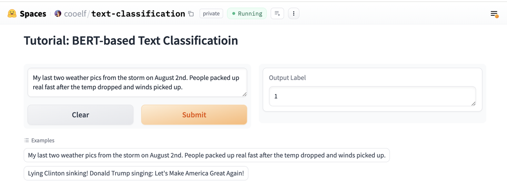


4. Easter egg: on the Spaces platform, you can see the weekly trending demos and search for LLMs or demos of interest to try out
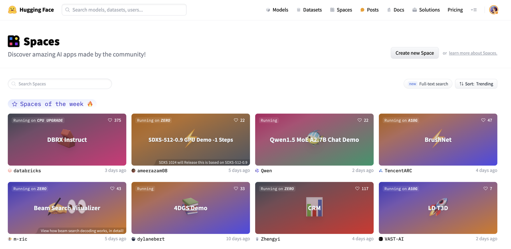


### 5. Advanced exercises
1. Try other classification/regression tasks, such as sentiment classification, news classification, vulnerability classification, etc.
2. Try other types of models, such as T5, ELECTRA, etc.
### 6. Other commonly used models
1. Question answering models: https://github.com/huggingface/transformers/tree/main/examples/pytorch/question-answering
2. Text summarization: https://github.com/huggingface/transformers/tree/main/examples/pytorch/summarization
3. Calling Llama2 for inference: https://huggingface.co/docs/transformers/en/model_doc/llama2
4. Lightweight fine-tuning of Llama2 (LoRA):   https://github.com/peremartra/Large-Language-Model-Notebooks-Course/blob/main/5-Fine%20Tuning/LoRA_Tuning_PEFT.ipynb


### 7. Further reading
1. A 43-page [survey](https://mp.weixin.qq.com/s?__biz=Mzk0MTYzMzMxMA==&mid=2247484539&idx=1&sn=6ee42baab4ad792e74ac6a89d7dd87d9&chksm=c2ce3e0af5b9b71c578cb6836e09cce5f60b4a1cfffadc1c4c98211fc0af621bfaaaa8fe0aff&mpshare=1&scene=24&srcid=0331FO6iqVqs5Vx3iHrtqouQ&sharer_shareinfo=45c3fb78d9cfb9627908da44dd7f5559&sharer_shareinfo_first=45c3fb78d9cfb9627908da44dd7f5559&key=a2847c972f830c4143e00e0430f657d8ab5acae4ad24ca628213273021453a3a9e17984627e2ab8506d1dcf6e1fabd9ec3123a5f71d2a65295ad6f6f56da2224d4a6e3228237c237447bbf48a6eff1f53e1971503f26c3fb5b9d99d27eca7266529a5f86d75bada7ec10bf314687bfcbf9fa3b09b8e36e73f6d6a154a5ce5ff0&ascene=14&uin=NzE3NzkyOTQx&devicetype=iMac20%2C1+OSX+OSX+14.2.1+build(23C71)&version=13080610&nettype=WIFI&lang=zh_CN&countrycode=CN&fontScale=100&exportkey=n_ChQIAhIQM7tgcovlhXp1y5J%2BRMnhfhL3AQIE97dBBAEAAAAAAFsTBwTm4FMAAAAOpnltbLcz9gKNyK89dVj0MxFZswDc%2Fk646vJPW2S3JFh8H2JhyZXiPbIl%2Bh23CsewrmIoZ4j0D2zMNylC3pLbhu9FIARUKYn%2F0r0OIdHnxesVFpw1qLo6uBJ3zmbsKBVXM05%2B0MiOBIfShfpiIfraK7THzak94U0RdS1flC%2BIDjTb5SmZs9Z4XTyTsN0QXR6NWjAXFeuxnMB4SENMJ8dUR8n08b3DGKtz9rfefn0JRlsX4mGcLvOFsFwg4nk35nl4C3Wgcs4OYociKm5UHabdhWT7%2FWbNNToZLD39eD%2FL4Xo%3D&acctmode=0&pass_ticket=8xG4QKOnJeEFUtXkScVmMqb3omdWJbPuc%2BhN5%2BA7%2FOXj7ex757M2ABNO4GVVnv2T3VtqrC9gZH%2FrU09rrUxJcA%3D%3D&wx_header=0) providing a comprehensive and in-depth analysis of large language models (LLMs) (by the author of Word2Vec)
   
    Paper title: Large Language Models: A Survey

    Paper link: https://arxiv.org/pdf/2402.06196.pdf

2. [GPT, GPT-2, GPT-3 paper deep dive [Paper Deep Dive]](https://www.bilibili.com/video/BV1AF411b7xQ?t=0.0)

3. [InstructGPT paper deep dive [Paper Deep Dive · 48]](https://www.bilibili.com/video/BV1hd4y187CR?t=0.4)
