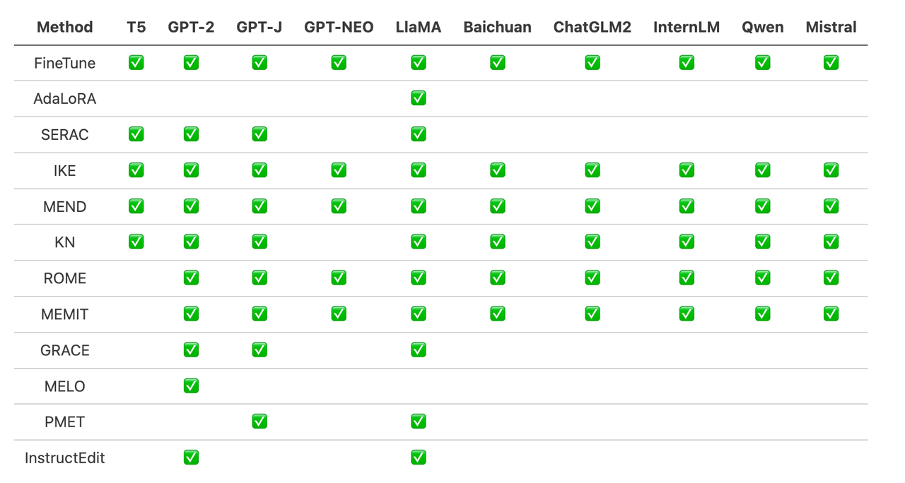
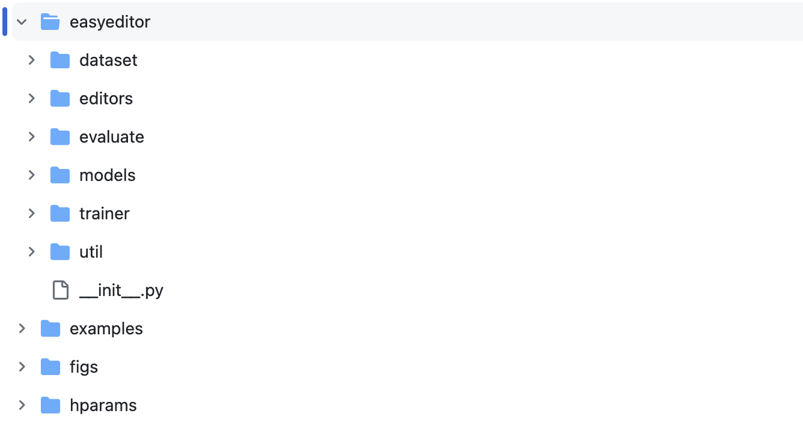
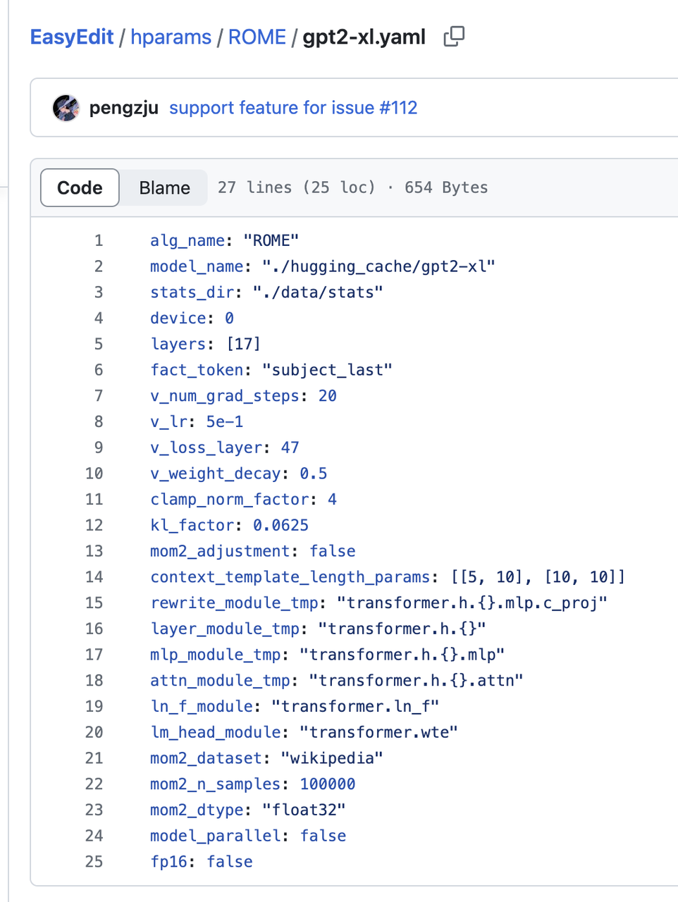
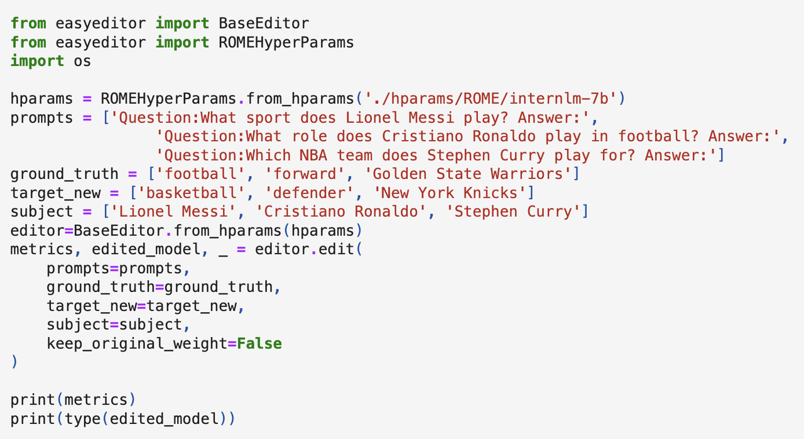
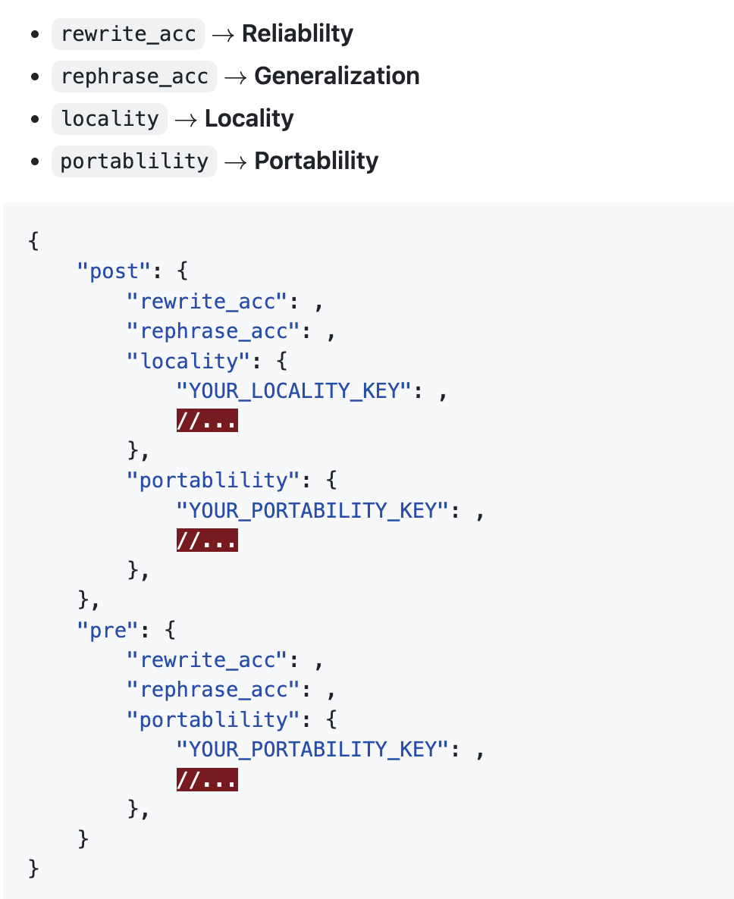

# Dive into Large Language Models: Knowledge Editing for Large Models
Introduction: Methods and tools for editing language models
> Want to control what a language model remembers about specific knowledge? Let's choose an appropriate editing method, edit the target knowledge, and verify the edited model!

## 1. Tutorial Goals:

- Become familiar with the EasyEdit toolkit
- Master language model editing methods (the simplest approach)
- Understand how to choose among different editing methods and their application scenarios

## 2. Preparation:
### 2.1 Get to know EasyEdit

https://github.com/zjunlp/EasyEdit

EasyEdit is a Python package for editing language models such as GPT-J, Llama, GPT-NEO, GPT2, and T5. Its goal is to effectively change the behavior of a language model for a specific piece of knowledge without negatively affecting performance on other inputs, while being easy to use and extend.

EasyEdit integrates existing popular editing methods:


### 2.2 Main Framework


EasyEdit contains a unified Editor, Method, and Evaluate framework, representing the editing scenario, editing technique, and evaluation method, respectively.
- Editor: describes the working scenario, including the model to be edited, the knowledge to be edited, and other necessary hyperparameters.
- Method: the specific knowledge editing method used (e.g., ROME, MEND, etc.).
- Evaluate: metrics for evaluating knowledge editing performance, including reliability, generality, locality, and portability.
- Trainer: some editing methods require a training process, which is implemented by the Trainer module.
## 3. Install the Environment:
```
git clone https://github.com/zjunlp/EasyEdit.git
(Optional) conda create -n EasyEdit python=3.9.7
cd EasyEdit
pip install -r requirements.txt
```
## 4. Editing Example
> Goal: change GPT-2-XL's knowledge memory, changing Lionel Messi's profession from football to basketball (football->basketball). 
Steps:
- Choose an editing method and prepare the parameters
- Prepare the data for knowledge editing
- Instantiate the Editor
- Run!
The following uses the ROME method as an example for a detailed introduction:
### 4.1 ROME
Jupyter Notebook: [https://colab.research.google.com/drive/1KkyWqyV3BjXCWfdrrgbR-QS3AAokVZbr?usp=sharing#scrollTo=zWfGkNb9FBJQ] 
- Choose an editing method and prepare the parameters
  - Choose ROME as the editing method and prepare the parameters required by ROME and GPT2-XL.
  - For example: alg_name: "ROME", model_name: "./hugging_cache/gpt2-xl" or the local path to the model, "device": the GPU index to use
  - The remaining parameters can be left at their defaults

- Prepare the data for knowledge editing
    ```
    prompts = ['Question:What sport does Lionel Messi play? Answer:'] # x_e
    ground_truth = ['football'] # y
    target_new = ['basketball'] # y_e
    subject = ['Lionel Messi'] 
    ```
- Instantiate the Editor: pass the prepared parameters to the BaseEditor class to instantiate it and obtain a customized Editor instance.
    ```
    hparams = ROMEHyperParams.from_hparams('./hparams/ROME/gpt2-xl.yaml')
    editor=BaseEditor.from_hparams(hparams)
    ```
- Run! Call the editor's edit method:
    ```
    metrics, edited_model, _ = editor.edit(
        prompts=prompts,
        ground_truth=ground_truth,
        target_new=target_new,
        subject=subject,
        keep_original_weight=False
    )
    ```

> Note: The first time you edit a model, the Wiki corpus will be downloaded, and the states of each layer will be computed for the model (stats_dir: "./data/stats") and saved for reuse in subsequent edits. Therefore, the first edit takes some time; as long as your network connection is stable, please be patient.
### 4.2 Verification and Evaluation
editor.edit returns metrics (computed by EasyEdit's Evaluate module). The format is:

To obtain values for generality, locality, and portability, you need to pass the data used for evaluation to the edit method.

Taking locality as an example, this causes the edit method to compute the locality metric, that is, the accuracy of the model's answers on locality_inputs.
```
locality_inputs = {
    'neighborhood':{
        'prompt': ['Joseph Fischhof, the', 'Larry Bird is a professional', 'In Forssa, they understand'],
        'ground_truth': ['piano', 'basketball', 'Finnish']
    }
}
metrics, edited_model, _ = editor.edit(
    prompts=prompts,
    ground_truth=ground_truth,
    target_new=target_new,
    locality_inputs=locality_inputs,
    keep_original_weight=False
)
```
Alternatively, directly compare the generation behavior of the model before and after editing.
```
generation_prompts = [
    "Lionel Messi, the",
    "The law in Ikaalinen declares the language"
]

model = GPT2LMHeadModel.from_pretrained('./hugging_cache/gpt2').to('cuda')
batch = tokenizer(generation_prompts, return_tensors='pt', padding=True, max_length=30)

pre_edit_outputs = model.generate(
    input_ids=batch['input_ids'].to('cuda'),
    attention_mask=batch['attention_mask'].to('cuda'),
    max_new_tokens=3
)
post_edit_outputs = edited_model.generate(
    input_ids=batch['input_ids'].to('cuda'),
    attention_mask=batch['attention_mask'].to('cuda'),
    max_new_tokens=3)
```
## 5. Scaling Up Editing (Optional)
### 5.1 Batch Edit
Multiple data items can be formed into parallel lists and passed to the edit method at the same time for batch editing; in this case, MEMIT is the best method. (https://colab.research.google.com/drive/1P1lVklP8bTyh8uxxSuHnHwB91i-1LW6Z)
```
prompts = ['Question:What sport does Lionel Messi play? Answer:',
            'The law in Ikaalinen declares the language']
ground_truth = ['football', 'Finnish']
target_new = ['basketball', 'Swedish']
subject = ['Lionel Messi', 'Ikaalinen']
```
### 5.2 Testing on Benchmarks
- Counterfact
- ZsRE
```
{
    "case_id": 4402,
    "pararel_idx": 11185,
    "requested_rewrite": {
      "prompt": "{} debuted on",
      "relation_id": "P449",
      "target_new": {
        "str": "CBS",
        "id": "Q43380"
      },
      "target_true": {
        "str": "MTV",
        "id": "Q43359"
      },
      "subject": "Singled Out"
    },
    "paraphrase_prompts": [
      "No one on the ground was injured.  v",
      "The sex ratio was 1063. Singled Out is to debut on"
    ],
    "neighborhood_prompts": [
      "Daria premieres on",
      "Teen Wolf was originally aired on",
      "Spider-Man: The New Animated Series was originally aired on",
      "Celebrity Deathmatch premiered on",
      "\u00c6on Flux premiered on",
      "My Super Psycho Sweet 16 premieres on",
      "Daria was released on",
      "Jersey Shore premiered on",
      "Skins was originally aired on",
      "All You've Got premiered on"
    ]
  }
  ```
https://github.com/zjunlp/EasyEdit/blob/main/examples/run_zsre_llama2.py 
